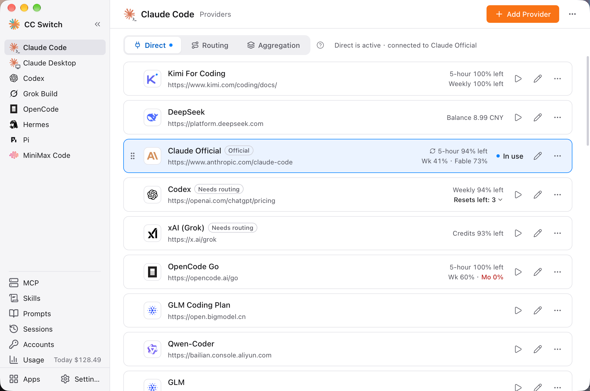
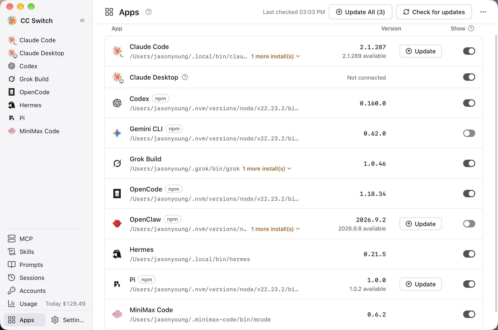
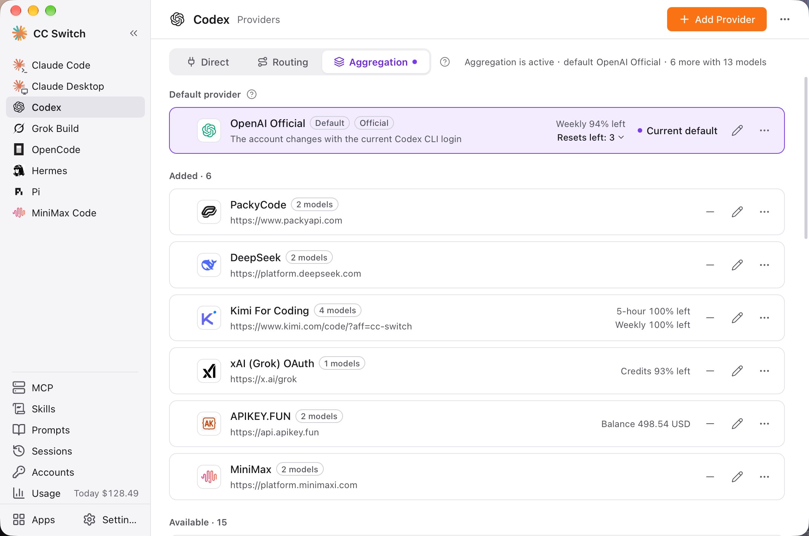
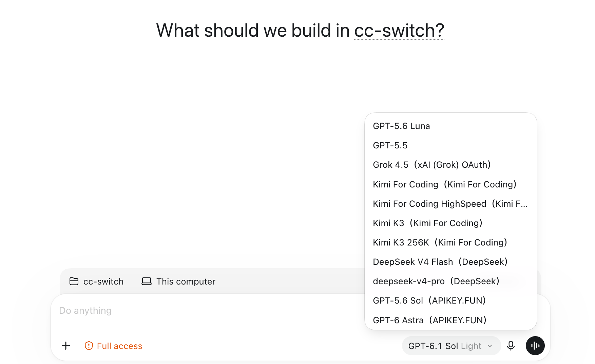
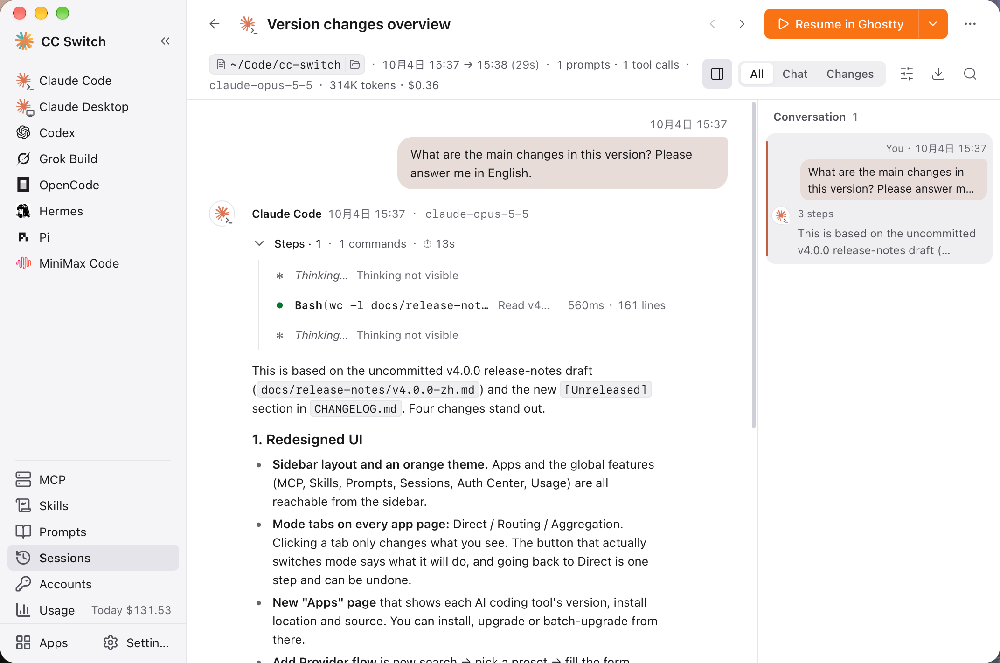
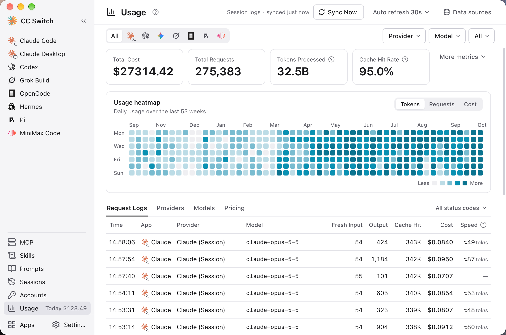

<div align="center">

# CC Switch

## [⬇ CC Switch Custom — Windows / macOS](https://github.com/asd260531078/cc-switch-custom/releases/latest)

### Универсальный менеджер для Claude Code, Claude Desktop, Codex, Gemini CLI, Grok Build, OpenCode, OpenClaw, Hermes Agent, Pi, MiniMax Code, Kimi Code и Oh My Pi

**Переключайте API-провайдеров в один клик и управляйте MCP, Skills и промптами в одном месте — больше никакой ручной правки конфигов JSON / TOML / YAML.**

[](https://github.com/asd260531078/cc-switch-custom/releases)
[](https://github.com/asd260531078/cc-switch-custom/releases)
[](https://tauri.app/)
[](https://github.com/asd260531078/cc-switch-custom/releases/latest)

<a href="https://trendshift.io/repositories/15372" target="_blank"></a>
<a href="https://www.star-history.com/#farion1231/cc-switch&Date"><picture><source media="(prefers-color-scheme: dark)" srcset="https://api.star-history.com/badge?repo=farion1231/cc-switch&theme=dark" /></picture></a>

<a href="https://trendshift.io/repositories/15372?utm_source=trendshift-badge&amp;utm_medium=badge&amp;utm_campaign=badge-trendshift-15372" target="_blank" rel="noopener noreferrer"></a>
<a href="https://trendshift.io/repositories/15372?utm_source=trendshift-badge&amp;utm_medium=badge&amp;utm_campaign=badge-trendshift-15372" target="_blank" rel="noopener noreferrer"></a>
<a href="https://trendshift.io/repositories/15372?utm_source=trendshift-badge&amp;utm_medium=badge&amp;utm_campaign=badge-trendshift-15372" target="_blank" rel="noopener noreferrer"></a>

### 🌐 Единственный официальный сайт: **[ccswitch.io](https://ccswitch.io)**

[English](README.md) | [简体中文](README_ZH.md) | [繁體中文](README_ZH-TW.md) | [日本語](README_JA.md) | [한국어](README_KO.md) | [Türkçe](README_TR.md) | Русский | [Deutsch](README_DE.md) | [История изменений](CHANGELOG.md)

**[Загрузка](#загрузка-и-установка) · [Быстрый старт](#быстрый-старт) · [Возможности](#возможности) · [FAQ](#faq) · [Руководство пользователя](docs/user-manual/en/README.md)**

</div>

Custom source version `4.0.3801` is based on official `v4.0.38`. See [custom release notes](docs/release-notes/v4.0.3801-zh.md) for changes and database upgrade guidance. Use [this repository’s Releases](https://github.com/asd260531078/cc-switch-custom/releases/latest) for Windows x64 and macOS Universal installers. The Homebrew and Linux instructions below refer to the official distribution.


## Зачем нужен CC Switch?

У каждого ИИ-инструмента для программирования, такого как Claude Code, Codex и Gemini CLI, свой формат конфигурации. Чтобы сменить API-провайдера, приходится вручную править файлы JSON, TOML, YAML или `.env`, а MCP, навыки и промпты нужно отдельно поддерживать в каждом инструменте.

**CC Switch** собирает всё это в одном десктопном приложении: выберите пресет, введите ключ и переключайтесь в один клик. При переключении заменяются только параметры подключения — адрес, ключ и модель, — поэтому плагины, хуки, MCP и добавленные вами комментарии остаются на месте.

- **Одно приложение — двенадцать инструментов** — Claude Code, Claude Desktop, Codex, Gemini CLI, Grok Build, OpenCode, OpenClaw, Hermes, Pi, MiniMax Code, Kimi Code и Oh My Pi
- **Больше никакой ручной правки** — более 90 пресетов провайдеров, включая AWS Bedrock, NVIDIA NIM и community-ретрансляторы
- **Напрямую, маршрутизация или агрегация — на ваш выбор** — «Напрямую» подключает инструмент прямо к провайдеру; «Маршрутизация» пересылает запросы через ваш компьютер, преобразуя форматы API и автоматически переключаясь на резерв, так что можно использовать GPT в Claude Code и Claude в Codex; «Агрегация» собирает модели нескольких провайдеров в один список моделей в Claude Code или Codex, и каждый запрос уходит провайдеру выбранной вами модели
- **Единые MCP, навыки и промпты** — добавьте MCP-серверы и навыки один раз, затем выберите, в какие инструменты их синхронизировать; промпты ведутся отдельно для каждого инструмента
- **Сессии, которые удобно читать** — превращает логи сессий каждого инструмента в режим чтения: что сделал каждый ход, какие файлы изменились и какой шаг завершился ошибкой — всё видно с первого взгляда
- **Статистика и квоты под рукой** — отслеживайте расход токенов и затраты даже без локальной маршрутизации; остаток квоты подписки и баланс аккаунтов отображаются прямо на карточках провайдеров и в трее
- **Кроссплатформенность** — нативное десктопное приложение для Windows, macOS и Linux, созданное на Tauri 2

## Скриншоты

<table>
<tr>
<td align="center" width="50%"><br>Главный экран</td>
<td align="center" width="50%"><br>Страница «Приложения»</td>
</tr>
<tr>
<td align="center"><br>Режим агрегации</td>
<td align="center"><br>Агрегированный список моделей в Codex</td>
</tr>
<tr>
<td align="center"><br>Режим чтения сессии</td>
<td align="center"><br>Статистика</td>
</tr>
</table>

## Загрузка и установка

### Системные требования

- **Windows**: Windows 10 и новее
- **macOS**: macOS 12 (Monterey) и новее
- **Linux**: x86_64 или ARM64 с glibc 2.35+ и WebKitGTK 4.1 — например, Ubuntu 22.04+, Debian 12+ и свежие выпуски Fedora; RHEL / Rocky / Alma 8–9 пока не поддерживаются

### Пользователям Windows

Скачайте со страницы [Releases](https://github.com/asd260531078/cc-switch-custom/releases/latest) последний установщик `CC-Switch-v{version}-Windows.msi` или портативную версию `CC-Switch-v{version}-Windows-Portable.zip`. Для Windows on ARM скачайте `CC-Switch-v{version}-Windows-arm64.msi` или `CC-Switch-v{version}-Windows-arm64-Portable.zip`.

### Пользователям macOS

**Способ 1: установка через Homebrew (рекомендуется)**

```bash
brew install --cask cc-switch
```

Обновление:

```bash
brew upgrade --cask cc-switch
```

**Способ 2: ручная загрузка**

Скачайте со страницы [Releases](https://github.com/asd260531078/cc-switch-custom/releases/latest) `CC-Switch-v{version}-macOS.dmg` (рекомендуется) или `.zip`. Это универсальная сборка, которая нативно работает как на Apple Silicon, так и на Mac с Intel.

> **Примечание**: CC Switch для macOS подписан кодом и нотаризован Apple. Его можно устанавливать и открывать напрямую.

### Пользователям Arch Linux

**Установка через paru (рекомендуется)**

```bash
paru -S cc-switch-bin
```

### Пользователям Linux

Скачайте последнюю сборку для Linux со страницы [Releases](https://github.com/farion1231/cc-switch/releases):

- `CC-Switch-v{version}-Linux-x86_64.deb` / `-Linux-arm64.deb` (Debian/Ubuntu)
- `CC-Switch-v{version}-Linux-x86_64.rpm` / `-Linux-arm64.rpm` (Fedora и другие RPM-дистрибутивы с WebKitGTK 4.1)
- `CC-Switch-v{version}-Linux-x86_64.AppImage` / `-Linux-arm64.AppImage` (любой дистрибутив, удовлетворяющий требованиям выше)

> **Flatpak**: не входит в официальные релизы. Его можно собрать самостоятельно из `.deb` — инструкции см. в [`flatpak/README.md`](flatpak/README.md).

## Быстрый старт

### Основы использования

1. **Добавьте провайдера**: выберите нужный инструмент на боковой панели, затем нажмите «+» (Добавить провайдера) в правом верхнем углу страницы → выберите пресет или создайте собственную конфигурацию
2. **Переключите провайдера**:
   - Главный экран: выберите провайдера → нажмите «Включить» (для OpenCode, OpenClaw, Hermes, MiniMax Code и Kimi Code кнопка называется «Добавить», а для Pi и Oh My Pi — «Включить» / «Удалить»; эти семь инструментов работают в режиме сосуществования, поэтому можно добавить сразу нескольких провайдеров)
   - Системный трей: для каждого инструмента одна строка вида «имя · режим · провайдер · квота»; нажмите на имя провайдера в её подменю, чтобы переключиться (Claude Code, Claude Desktop, Codex, Gemini CLI и Grok Build)
3. **Применение**: Claude Code не требует перезапуска; для Codex, Gemini CLI и Grok Build перезапустите терминал или CLI-инструмент; для Claude Desktop перезапустите само приложение (см. FAQ)
4. **Возврат к официальному входу**: переключитесь на встроенного официального провайдера в списке (например, «Claude Official»), перезапустите инструмент, затем пройдите его процедуру входа / OAuth
5. **Маршрутизация и агрегация (необязательно)**: на страницах Claude Code, Codex, Gemini CLI и Grok Build вверху есть вкладки «Напрямую» / «Маршрутизация», а у Claude Code и Codex — ещё и «Агрегация». Нажатие на вкладку лишь меняет то, что вы просматриваете, и не затрагивает вашу конфигурацию; чтобы действительно переключиться, нажмите на странице «Начать маршрутизацию» или «Перейти к агрегации», а для возврата — «Вернуться к прямому подключению». Используйте маршрутизацию, чтобы применять провайдеров в формате OpenAI или Gemini в Claude Code либо Claude в Codex; используйте агрегацию, чтобы собрать модели нескольких провайдеров в одном списке моделей
6. **Управление инструментами**: страница «Приложения» на боковой панели показывает версию, расположение установки и источник каждого ИИ-инструмента для программирования в одном месте; вы можете устанавливать и обновлять инструменты по одному или все сразу, а также выбирать, какие инструменты показывать на боковой панели

### MCP, промпты, навыки, проекты и сессии

- **MCP**: нажмите «MCP» на боковой панели → добавьте серверы через шаблоны или собственную конфигурацию (либо «Импортировать существующие») → включите синхронизацию для каждого инструмента
- **Промпты**: нажмите «Промпты» на боковой панели → создавайте промпты в Markdown-редакторе → включите один из них, чтобы записать его в файл промпта этого инструмента
- **Навыки**: нажмите «Навыки» на боковой панели → «Открыть навыки» → ищите по skills.sh или просматривайте репозитории GitHub → установка в один клик в поддерживаемые инструменты
- **Проекты**: сначала включите «Показывать переключатель проектов» в «Настройки → Основные», затем на странице Claude Code, Claude Desktop или Codex откройте переключатель проектов вверху → «Новый проект», чтобы сохранить текущую конфигурацию; позже выберите проект в переключателе, чтобы разом сменить всю настройку
- **Сессии**: нажмите «Сессии» на боковой панели → просматривайте и ищите историю разговоров, открывайте режим чтения или восстанавливайте сессии каждого инструмента
- **Аккаунты**: нажмите «Аккаунты» на боковой панели, чтобы войти в аккаунты GitHub Copilot, ChatGPT, xAI (Grok) и Kimi Code и использовать свои подписки как провайдеров. Kimi Code поддерживает несколько официальных аккаунтов, у каждого из которых отдельные учётные данные и собственный нативный провайдер; первый вход использует нативный слот учётных данных Kimi по умолчанию. Здесь же управляются вход, повторная аутентификация и выход. Официальные узлы Kimi OAuth, всё ещё присутствующие в нативной конфигурации, защищены на странице провайдера; сохранённые профили можно удалить после удаления их нативных узлов.

> **Примечание**: при первом запуске CC Switch автоматически импортирует вашу существующую конфигурацию Claude Code, Codex, Gemini CLI и Grok Build как провайдера с именем `default` и добавляет официального провайдера для каждого из этих инструментов и для Claude Desktop, так что ничего из настроенного вами не потеряется.

Подробные руководства по каждой функции см. в **[Руководстве пользователя](docs/user-manual/en/README.md)** (на английском): управление провайдерами, MCP / промпты / навыки, локальная маршрутизация и резервное переключение и многое другое.

## Возможности

[Полная история изменений](CHANGELOG.md) | [Примечания к релизу v4.0](docs/release-notes/v4.0.4-en.md)

### Поддерживаемые функции по инструментам

| Инструмент | Провайдеры | Локальная маршрутизация | Агрегация | Переключение из трея | MCP | Навыки | Промпты | Сессии | Статистика |
| --- | --- | :---: | :---: | :---: | :---: | :---: | --- | :---: | :---: |
| Claude Code | Переключение | ✓ | ✓ | ✓ | ✓ | ✓ | CLAUDE.md | ✓ | ✓ |
| Claude Desktop | Переключение | Только сопоставление моделей | – | ✓ | – | – | – | – | Только сопоставление моделей |
| Codex | Переключение | ✓ | ✓ | ✓ | ✓ | ✓ | AGENTS.md | ✓ | ✓ |
| Gemini CLI | Переключение | ✓ | – | ✓ | ✓ | ✓ | GEMINI.md | ✓ | ✓ |
| Grok Build | Переключение | ✓ | – | ✓ | ✓ | ✓ | AGENTS.md | ✓ | ✓ |
| OpenCode | Сосуществование | – | – | – | ✓ | ✓ | AGENTS.md | ✓ | ✓ |
| OpenClaw | Сосуществование | – | – | – | – | – | Редактор рабочей области | ✓ | – |
| Hermes | Сосуществование | – | – | – | ✓ | ✓ | Память | ✓ | – |
| Pi | Сосуществование | – | – | – | ✓ | ✓ | AGENTS.md, SYSTEM.md, шаблоны промптов | ✓ | ✓ |
| MiniMax Code | Сосуществование | – | – | – | ✓ | ✓ | AGENTS.md | ✓ | ✓ |
| Kimi Code | Сосуществование | – | – | – | ✓ | ✓ | AGENTS.md | ✓ | ✓ |
| Oh My Pi | Сосуществование | – | – | – | ✓ | ✓ | AGENTS.md | ✓ | – |

- **Переключение**: одновременно активен только один провайдер; **Сосуществование**: несколько провайдеров одновременно записываются в собственный конфиг инструмента, а выбираете вы уже внутри инструмента.
- **Локальная маршрутизация**: CC Switch пересылает запросы на вашем компьютере и преобразует форматы API; см. [Локальная маршрутизация и резервное переключение](#локальная-маршрутизация-и-резервное-переключение) ниже. Провайдеры Claude Desktop могут работать в режиме «Напрямую» или «Сопоставление моделей»; при «Сопоставлении моделей» запросы идут через локальную маршрутизацию.
- **Агрегация**: собирает модели нескольких провайдеров в один список моделей и отправляет каждый запрос провайдеру выбранной вами модели; см. [Режим агрегации](#режим-агрегации) ниже.
- **Сессии**: просмотр и поиск по истории разговоров, режим чтения и копирование команды возобновления для продолжения разговора (возобновление сессий OpenClaw и Hermes пока не поддерживается). Hermes показывает только 500 последних сессий.
- **Статистика**: без локальной маршрутизации использование собирается из локальных логов сессий каждого инструмента; запросы, проходящие через локальную маршрутизацию, также учитываются.
- Панели MCP, навыков, промптов и сессий, открытые со страницы Claude Desktop, относятся к Claude Code.

### Управление провайдерами

- **Более 90 пресетов провайдеров** — выберите пресет и введите ключ, чтобы добавить провайдера, либо создайте собственную конфигурацию. Панель добавления позволяет искать по названию (включая китайские названия) и домену, а разные тарифы и регионы одного вендора объединены в одну строку
- **Только ключевые поля** — при переключении заменяются лишь параметры подключения: адрес, ключ и модель; плагины, хуки, MCP, добавленные вами настройки и комментарии остаются на месте. Редактор показывает, как будет выглядеть файл конфигурации после переключения, а CC Switch автоматически создаёт резервную копию каждого файла конфигурации перед его первой перезаписью
- **Проекты** — сохраняйте текущий провайдер, MCP, навыки и файлы промптов Claude Code или Codex как проект (для Claude Desktop сохраняется только провайдер), затем переключайте всю настройку в один клик через переключатель проектов вверху страницы или из трея; при переходе на другой проект текущее состояние автоматически сохраняется обратно в предыдущий. Переключатель проектов по умолчанию скрыт; включите «Показывать переключатель проектов» в «Настройки → Основные»
- **Аккаунты (бета)** — входите в несколько аккаунтов GitHub Copilot, ChatGPT и xAI (Grok) в разделе «Аккаунты» на боковой панели и используйте эти подписки как провайдеров в Claude Code, Claude Desktop и Codex (всё, кроме OpenAI Official в Codex, нужно использовать в режиме маршрутизации). Использование подписки вне официального клиента может нарушать условия использования вендора; оценивайте риск самостоятельно
- **Сторонние провайдеры для Claude Desktop** — подключайтесь напрямую к Anthropic-совместимым эндпоинтам; для не-Claude моделей выберите «Сопоставление моделей», чтобы через локальную маршрутизацию сопоставить уровни вроде Sonnet, Opus и Haiku реальным моделям провайдера
- **Универсальные провайдеры** — одна конфигурация синхронизируется с Claude Code, Codex и Gemini CLI
- Переключение в один клик, быстрое переключение из системного трея (Claude Code, Claude Desktop, Codex, Gemini CLI, Grok Build), сортировка перетаскиванием, импорт/экспорт

### Локальная маршрутизация и резервное переключение

- **Преобразование форматов API** — локальная маршрутизация преобразует запросы между Anthropic Messages, OpenAI Chat Completions, OpenAI Responses и Gemini Native: Claude Code и Claude Desktop могут использовать провайдеров в формате OpenAI или Gemini, а Codex и Grok Build — провайдеров Chat Completions или Anthropic Messages
- **Переключатель для каждого инструмента** — Claude Code, Codex, Gemini CLI и Grok Build могут входить в режим маршрутизации по отдельности: нажмите «Начать маршрутизацию» на вкладке «Маршрутизация» вверху страницы. В режиме маршрутизации смена провайдера вступает в силу сразу для последующих запросов (Codex, Gemini CLI и Grok Build всё же могут потребовать перезапуска, если переключение меняет модель). При выходе из CC Switch он сначала записывает обратно прямую конфигурацию и снова подключается при следующем запуске
- **Автоматическое резервное переключение** — настройте очередь резервного переключения для каждого инструмента; при ошибке запроса CC Switch автоматически переходит к следующему провайдеру в очереди, опираясь на размыкатель цепи (circuit breaker) и мониторинг состояния провайдеров
- **Ректификатор** — автоматически исправляет некоторые запросы, которые не могут обработать отдельные вышестоящие сервисы (например, подписи Thinking или откат, когда изображения не поддерживаются)
- Официальные провайдеры (например, Claude Official) не могут работать через локальную маршрутизацию (кроме OpenAI Official в Codex)
- Статус службы маршрутизации, адрес прослушивания и настройки резервного переключения находятся в «Настройки → Локальная маршрутизация»
- Руководства: [Использование GPT в Claude Code](docs/guides/claude-codex-routing-guide-en.md) · [Использование Claude в Codex](docs/guides/codex-claude-routing-guide-en.md)

### Режим агрегации

- **Один список моделей — много провайдеров** — на странице Claude Code или Codex переключитесь на «Агрегацию» и добавьте нескольких провайдеров; все их модели появятся в списке выбора моделей клиента. Каждый запрос уходит провайдеру выбранной вами модели, без необходимости переключаться в CC Switch
- **Добавляйте и удаляйте в любой момент** — нажмите «Добавить» или «Удалить» на карточке провайдера, затем выберите одного провайдера по умолчанию; запросы, не указывающие агрегированную модель, уходят ему. OpenAI Official в Codex может быть только провайдером по умолчанию; официальные подписки Claude в агрегации пока не поддерживаются
- **Примечания** — агрегация не обеспечивает резервного переключения; для Claude Code требуется версия 2.1.243 или новее; Codex нужно перезапускать после изменения агрегированного списка, а Claude Code — нет. При смене модели внутри сессии новой модели приходится заново строить кэш промптов, поэтому первый ход обходится чуть дороже
- Значительная часть дизайна режима агрегации опирается на [opencodex](https://github.com/lidge-jun/opencodex) — благодарим его автора и участников
- Документация: [Руководство по режиму агрегации](docs/user-manual/en/4-proxy/4.6-aggregation.md) · [Иллюстрированное руководство (на китайском)](docs/guides/aggregation-mode-guide-zh.md)

### MCP, промпты и навыки

- **Единая панель MCP** — управляйте всеми MCP-серверами в одном месте, выбирайте, в какие инструменты синхронизировать каждый из них (Claude Code, Codex, Gemini CLI, Grok Build, OpenCode, Hermes, Pi, MiniMax Code, Kimi Code, Oh My Pi), импортируйте существующие конфиги из каждого инструмента и импортируйте через Deep Link
- **Промпты** — библиотека промптов для каждого инструмента с Markdown-редактором; включение промпта записывает его в файл промпта этого инструмента (CLAUDE.md / AGENTS.md / GEMINI.md), при этом существующее содержимое файла сначала сохраняется в библиотеку, так что ничего не теряется. В Pi также можно редактировать SYSTEM.md, APPEND_SYSTEM.md и шаблоны промптов
- **Навыки** — ищите по skills.sh или устанавливайте в один клик из репозиториев GitHub или ZIP-файлов; проверяйте обновления и обновляйте всё одним кликом; синхронизируйте с каждым инструментом автоматически, только через символические ссылки или только копированием; при желании их можно хранить в `~/.agents/skills`
- Все три панели поддерживают поиск, а MCP и навыки можно также включать или отключать для инструмента разом; провайдеры, MCP-серверы и промпты редактируются на всю страницу в области содержимого, и перед уходом с несохранёнными изменениями вас предупредят

### Учёт использования и стоимости

- **Панель статистики** — работает без локальной маршрутизации: по умолчанию автоматически сканирует локальные логи сессий каждого инструмента и отслеживает запросы, токены, долю попаданий в кэш, скорость вывода и затраты по провайдерам и моделям, с графиками трендов, тепловой картой за весь год и журналами по каждому запросу
- **Квоты и балансы** — карточки провайдеров и трей показывают остаток и обратный отсчёт до сброса, например «5h 94% left»: квоты официальных подписок (Claude, ChatGPT, Gemini, SuperGrok), 5-часовые / недельные / месячные квоты Coding Plan (Kimi, Zhipu GLM, MiniMax, Volcengine Ark и др.) и балансы аккаунтов (DeepSeek, OpenRouter, SiliconFlow и др.); некоторые нужно сначала включить через «Настроить запрос использования» на карточке провайдера, а для остальных провайдеров можно написать собственный скрипт использования. Подписки ChatGPT также показывают оставшиеся сбросы лимитов и баланс Codex Credits
- **Собственные цены** — задавайте цены по моделям или импортируйте их из models.dev

### Менеджер сессий и рабочая область

- **Режим чтения сессий** — разбирает логи сессий каждого инструмента в структурированное содержимое: текст, размышления, вызовы инструментов, их результаты и изображения показываются раздельно; каждый ход работы сворачивается в однострочную сводку (сколько шагов, сколько файлов изменено, сколько ошибок), неудачные шаги отмечены красным; справа находится структура разговора, поиск внутри сессии, экспорт в Markdown и копирование отдельного хода или всего разговора
- **Список и возобновление** — группировка по проекту или времени, поиск по заголовкам, каталогам, сообщениям или ID сессий и массовое удаление; копирование команды возобновления для продолжения разговора, а в macOS — возобновление в терминале в один клик
- **Редактор рабочей области** (OpenClaw) — редактируйте файлы агента (AGENTS.md, SOUL.md и т. д.) и ежедневную память
- **Память** (Hermes) — редактируйте MEMORY.md и USER.md Hermes

### Система и платформа

- **Облачная синхронизация** — синхронизация между устройствами через WebDAV (Jianguoyun, Nextcloud, Synology NAS и др.) или S3-совместимое хранилище (AWS S3, Cloudflare R2, Alibaba Cloud OSS, Tencent Cloud COS и др.); каталог конфигурации CC Switch можно также поместить в папку облачного диска, например Dropbox, OneDrive или iCloud
- **Управление CLI-инструментами** — на странице «Приложения» на боковой панели смотрите текущие и последние версии инструментов командной строки, таких как Claude Code и Codex, устанавливайте и обновляйте их или обновляйте все сразу в один клик и диагностируйте дублирующиеся установки; в Windows можно также управлять инструментами внутри WSL (см. FAQ)
- **Deep Link** (`ccswitch://`) — импортируйте провайдеров, MCP-серверы и промпты или добавляйте репозитории навыков в один клик по ссылке; создавайте ссылки в [онлайн-генераторе](https://ccswitch.io/deplink.html); владельцам сайтов, которые хотят добавить кнопку импорта, пригодится [руководство по интеграции](https://github.com/farion1231/cc-switch/blob/main/docs/guides/deeplink-site-integration-guide-en.md)
- **Встроенные утилиты** — пропуск подтверждения при первом запуске Claude Code, скрытие ИИ-атрибуции, возможность для расширения Claude Code в VS Code следовать переключениям провайдеров CC Switch и многое другое
- Тёмная / светлая / системная тема, автозапуск, автообновление, атомарная запись, автоматические резервные копии (где лежит каждая копия и сколько места она занимает, видно в «Настройки → Данные»), i18n (упрощённый китайский, традиционный китайский, английский, японский, корейский, турецкий, русский, немецкий)

## FAQ

<details>
<summary><strong>Какие ИИ-инструменты поддерживает CC Switch?</strong></summary>

CC Switch поддерживает двенадцать инструментов: **Claude Code**, **Claude Desktop**, **Codex**, **Gemini CLI**, **Grok Build**, **OpenCode**, **OpenClaw**, **Hermes**, **Pi**, **MiniMax Code**, **Kimi Code**, **Oh My Pi**. Для каждого инструмента есть свои пресеты провайдеров и управление конфигурацией; что именно поддерживает каждый, см. в разделе [Поддерживаемые функции по инструментам](#поддерживаемые-функции-по-инструментам).

</details>

<details>
<summary><strong>Нужно ли перезапускать терминал после смены провайдера?</strong></summary>

Зависит от инструмента:

- **Claude Code**: поддерживает горячее переключение данных провайдера — перезапуск не нужен.
- **Codex, Gemini CLI, Grok Build**: перезапустите терминал или CLI-инструмент, чтобы изменения вступили в силу (CC Switch напомнит об этом после переключения). В режиме маршрутизации запросы сразу идут к новому провайдеру, но все три инструмента всё же могут потребовать перезапуска, если переключение меняет модель.
- **Режим агрегации**: изменения агрегированных моделей Claude Code вступают в силу сразу; для Codex вход в агрегацию и выход из неё, а также изменение агрегированного списка моделей требуют полного перезапуска — см. следующий вопрос.
- **Claude Desktop**: полностью закройте и снова откройте Claude Desktop; при использовании «Сопоставления моделей» также держите CC Switch запущенным.
- **OpenCode, OpenClaw, Hermes, Pi, MiniMax Code, Kimi Code, Oh My Pi**: эти инструменты работают в режиме сосуществования — нажатие «Добавить» («Включить» для Pi и Oh My Pi) записывает провайдера в собственный конфиг инструмента рядом с остальными; затем вы выбираете нужную модель внутри инструмента. В Kimi Code также есть кнопка «Переключить» для выбора модели провайдера; модели, на которые всё ещё ссылаются как на основные или вторичные, удалить нельзя. Подробности о конфигурации и аккаунтах см. в [руководстве по интеграции Kimi Code](docs/kimi-code-integration-zh.md) (на китайском).

</details>

<details>
<summary><strong>Почему в режиме агрегации агрегированные модели не отображаются в /model Codex?</strong></summary>

Codex читает список моделей только при запуске. После входа в режим агрегации или выхода из него, добавления либо удаления агрегированного провайдера или изменения агрегированных моделей провайдера полностью перезапустите Codex, чтобы увидеть новый список:

- **Codex CLI**: закрыть терминал и снова запустить `codex` недостаточно. Все `codex` во всех терминалах используют один общий фоновый демон, и его нужно перезапустить, чтобы он подхватил новый список. Когда CC Switch обнаруживает, что Codex всё ещё использует старый список, он показывает уведомление вверху страницы Codex; нажмите в нём «Перезапустить демон Codex». Перезапуск прерывает все задачи, выполняемые в демоне.
- **Десктопное приложение Codex**: полностью закройте его и откройте снова (нажмите ⌘Q в macOS; закрытия окна недостаточно).
- **Расширения для редакторов**: заново откройте окно редактора.

Claude Code это не затрагивает: изменения агрегированных моделей вступают в силу сразу.

</details>

<details>
<summary><strong>Изменит ли переключение провайдеров мои плагины, хуки или другие настройки?</strong></summary>

Нет. Когда вы переключаете провайдеров для Claude Code, Codex, Gemini CLI или Grok Build, CC Switch заменяет в файле конфигурации только **ключевые поля**: адрес, ключ, название модели и протокол API (а также уровень рассуждения для Codex и способ аутентификации для Gemini CLI), вместе с несколькими параметрами совместимости, относящимися к провайдеру (например, «Отключить Artifact Tool» и контекстное окно в Claude Code). Плагины, хуки, разрешения, MCP, добавленные вами переменные окружения, комментарии и форматирование остаются как есть и действуют для всех провайдеров.

Эти общие настройки можно менять в самом инструменте или правкой файла конфигурации вручную. Также можно редактировать любого провайдера в CC Switch: редактор показывает, «как будет выглядеть файл конфигурации после переключения на этого провайдера». При сохранении ключевые поля сохраняются в этом провайдере, а все остальные изменения записываются в файл конфигурации и действуют для всех провайдеров.

Поэтому прежний «фрагмент общей конфигурации» больше не нужен, и его кнопки удалены. Настройки, которые были в вашем фрагменте до обновления, уже были записаны в файл конфигурации при переключении, так что они сохраняются. Перед первой перезаписью каждого файла конфигурации CC Switch также делает резервную копию оригинала в `~/.cc-switch/backups/live-first-write/`.

</details>

<details>
<summary><strong>Я сменил модель внутри инструмента — почему она возвращается после переключения туда и обратно?</strong></summary>

Модель — это ключевое поле, которое принадлежит провайдеру. Модель, выбранная внутри инструмента (например, через `/model` в Claude Code), действует до следующего переключения; при переключении модель в файле конфигурации заменяется той, что сохранена в целевом провайдере, а выбранную вами модель CC Switch обратно в предыдущего провайдера не сохраняет. Чтобы пользоваться моделью постоянно, отредактируйте этого провайдера в CC Switch.

Старые версии при переключении сохраняли весь файл конфигурации обратно в провайдера. Теперь так не происходит: это закрепляло плагины и другие общие настройки в одном провайдере, и они терялись при переключении на другого.

</details>

<details>
<summary><strong>Почему нельзя удалить используемого в данный момент провайдера?</strong></summary>

CC Switch следует принципу проектирования «минимального вмешательства» — даже если удалить приложение, ваши инструменты продолжат нормально работать.

Поэтому для инструментов с одним активным провайдером (Claude Code, Claude Desktop, Codex, Gemini CLI, Grok Build) система всегда сохраняет одну используемую конфигурацию, ведь удаление всех конфигураций сделало бы соответствующий инструмент неработоспособным; чтобы удалить её, сначала переключитесь на другого провайдера. Аналогично, провайдера по умолчанию в режиме агрегации удалить нельзя; сначала сделайте провайдером по умолчанию другого. Инструменты в режиме сосуществования (OpenCode, OpenClaw, Hermes, Pi и MiniMax Code) на это ограничение не распространяются — любого провайдера можно удалить напрямую. Если вы редко пользуетесь каким-то инструментом, его можно скрыть с боковой панели на странице «Приложения». Как вернуться к официальному входу, см. следующий вопрос.

</details>

<details>
<summary><strong>Как вернуться к официальному входу?</strong></summary>

В CC Switch списки провайдеров Claude Code, Claude Desktop, Codex, Gemini CLI и Grok Build содержат по встроенному официальному провайдеру (**Claude Official**, **Claude Desktop Official**, **OpenAI Official**, **Google Official**, **Grok Official**); если вы его удалили, добавьте его снова из пресетов. После переключения на официального провайдера пройдите собственный процесс входа инструмента (например, `/login` в Claude Code, `codex login` для Codex), и затем можно свободно переключаться между официальным провайдером и сторонними.

Для Codex можно также войти в несколько аккаунтов ChatGPT прямо в CC Switch через «Войти через аккаунт ChatGPT» и выбрать «Используемый аккаунт» для каждой карточки **OpenAI Official**, так что переключение между несколькими аккаунтами Plus, Pro или Team занимает один клик; карточки, для которых выбрано «Следовать входу Codex», продолжают использовать собственный вход Codex CLI.

Примечание: официальные подписки используют собственный вход инструмента и не проходят через локальную маршрутизацию. Официальных провайдеров нельзя выбрать в режиме маршрутизации (исключение — карточки OpenAI Official в Codex); сначала вернитесь к режиму «Напрямую».

</details>

<details>
<summary><strong>Почему после запуска маршрутизации мой конфиг указывает на 127.0.0.1?</strong></summary>

В режиме маршрутизации запросы инструмента сначала идут в локальную маршрутизацию CC Switch (по умолчанию `http://127.0.0.1:15721`), а затем CC Switch пересылает их выбранному вами провайдеру. Поэтому в файле конфигурации инструмента находятся только локальный адрес и ключ-заглушка `PROXY_MANAGED`; для Claude Code название модели тоже записывается как фиксированный псевдоним, например `claude-sonnet-5` (меню `/model` по-прежнему показывает реальное название модели). Реальный адрес провайдера, ключ и модель хранятся в CC Switch. Режим агрегации работает так же.

В журналах запросов в разделе «Статистика» на боковой панели для каждого запроса видно «запрошенная модель → фактическая модель».

В режиме маршрутизации переключение меняет провайдера, которого использует маршрутизация; провайдер, которым вы пользовались до входа в маршрутизацию, остаётся прежним и помечен на своей карточке как «Напрямую». Когда вы нажимаете «Вернуться к прямому подключению», в файл конфигурации записывается обратно конфигурация этого прямого провайдера. Выход из CC Switch также сначала записывает обратно прямого провайдера, а при следующем запуске CC Switch подключается снова.

</details>

<details>
<summary><strong>Можно ли использовать в Claude Code OpenAI-совместимые API, Gemini или локальные модели?</strong></summary>

Да, но для этого нужна маршрутизация. При редактировании провайдера задайте «Формат API» в «Дополнительных параметрах» в соответствии с API провайдера: выберите «OpenAI Chat Completions» для сервисов, предлагающих только эндпоинт Chat Completions (как многие серверы локальных моделей), «OpenAI Responses API» для сервисов с эндпоинтом Responses и «Gemini Native generateContent» для Gemini. Затем нажмите «Начать маршрутизацию» на вкладке «Маршрутизация» страницы Claude Code. Выбор неверного формата или незапущенная маршрутизация обычно приводят к ошибке 404 или 405.

И наоборот, если в Codex или Grok Build выбрать «Anthropic Messages» в качестве «Формата upstream», можно использовать провайдеров в формате Claude; для этого тоже нужна маршрутизация. Подробности см. в [Использование GPT в Claude Code](docs/guides/claude-codex-routing-guide-en.md) и [Использование Claude в Codex](docs/guides/codex-claude-routing-guide-en.md).

</details>

<details>
<summary><strong>«Проверка доступности» пройдена — почему запросы всё равно не работают?</strong></summary>

«Проверка доступности» на карточке провайдера лишь проверяет, достижим ли адрес провайдера; реальный запрос к модели она не отправляет, поэтому не может подтвердить, верны ли API-ключ и название модели. Если запросы не проходят, проверьте ключ, название модели и формат upstream; для запросов, идущих через маршрутизацию, точную ошибку можно также увидеть в журналах запросов в разделе «Статистика» на боковой панели.

</details>

<details>
<summary><strong>Где хранятся мои данные?</strong></summary>

По умолчанию всё хранится в папке `.cc-switch` в вашем домашнем каталоге (`C:\Users\<user>\.cc-switch` в Windows):

- **База данных**: `cc-switch.db` (SQLite — провайдеры, MCP, промпты, навыки, проекты, записи об использовании и т. д.)
- **Локальные настройки**: `settings.json` (настройки уровня устройства, такие как каталог конфигурации каждого инструмента, политика резервного копирования и данные подключения к облачной синхронизации)
- **Резервные копии**: `backups/` (автоматически создаются каждые 24 часа по умолчанию, хранятся 10 последних; настраивается в «Настройки → Данные → Резервное копирование и восстановление»; ниже «Другие резервные копии» перечисляют расположение и размер всех прочих копий, которые можно очищать по категориям)
- **Навыки**: `skills/` (в настройках можно изменить на `~/.agents/skills`), по умолчанию синхронизируются с каждым инструментом через символические ссылки, а при неудаче — копированием
- **Резервные копии навыков**: `skill-backups/` (создаются автоматически перед удалением или обновлением навыка, хранятся 20 последних)
- **Учётные данные OAuth-входа**: `copilot_auth.json`, `codex_oauth_auth.json`, `xai_oauth_auth.json`
- **Логи**: `logs/cc-switch.log` и `crash.log` — приложите их при сообщении о проблеме
- **Состояние устройства**: `live-state.json` (в каком режиме — «Напрямую», «Маршрутизация» или «Агрегация» — сейчас находится каждый инструмент и что было записано последним), `codex-login-stash.json` (официальный вход Codex, отложенный в сторону при переключении на стороннего провайдера и возвращаемый при переключении обратно на официального)
- **Исходные файлы конфигурации**: `backups/live-first-write/` (файл конфигурации каждого инструмента в том виде, в каком он был до первой перезаписи CC Switch)

После изменения «Каталог конфигурации CC Switch» в «Настройки → Данные → Расположение» все перечисленные выше файлы, кроме `settings.json`, состояния устройства и исходных файлов конфигурации, хранятся в новом каталоге. CC Switch не переносит существующие файлы автоматически, поэтому сначала скопируйте их вручную. `settings.json`, состояние устройства и исходные файлы конфигурации принадлежат только этому компьютеру: они всегда остаются в каталоге по умолчанию и не входят в облачную синхронизацию.

</details>

<details>
<summary><strong>Как управлять инструментами внутри WSL в Windows?</strong></summary>

CC Switch не определяет WSL автоматически. В «Настройки → Конфигурация приложений» измените каталог конфигурации соответствующего инструмента на путь внутри WSL, например `\\wsl.localhost\Ubuntu\home\<user>\.claude`; после сохранения CC Switch читает и записывает конфигурацию внутри WSL (поддерживается для Claude Code, Codex, Gemini CLI, Grok Build, OpenCode, OpenClaw, Hermes и Pi). После этого страница «Приложения» на боковой панели также обнаруживает и обновляет этот инструмент в соответствующем дистрибутиве WSL.

Примечание: «Маршрутизация» и «Агрегация» записывают в конфигурацию адрес `127.0.0.1`. В сетевом режиме NAT по умолчанию в WSL2 `127.0.0.1` внутри WSL не может достучаться до локальной маршрутизации в Windows; вместо этого переключите WSL в режим зеркальной сети (mirrored).

</details>

<details>
<summary><strong>Есть ли версия для командной строки или без графического интерфейса?</strong></summary>

CC Switch сам по себе поставляется только как десктопное приложение, которому нужен графический интерфейс (системные требования см. в разделе [Загрузка и установка](#загрузка-и-установка)). Для серверов, SSH-сессий или машин без графического окружения рекомендуем поддерживаемый сообществом **[CC Switch CLI](https://github.com/SaladDay/cc-switch-cli)**: он предлагает как интерактивный терминальный интерфейс (TUI), так и режим командной строки, поддерживает Claude Code, Codex, Gemini CLI, OpenCode, OpenClaw, Hermes и Pi, а устанавливается через Homebrew (`brew install cc-switch-cli`) или установочный скрипт.

По умолчанию CC Switch CLI использует тот же каталог данных `~/.cc-switch`, что и десктопное приложение, и совместим с его синхронизацией через WebDAV. Эти два проекта выпускаются отдельно, и версия базы данных, поддерживаемая CLI, иногда отстаёт от десктопного приложения; если вы видите сообщение «версия базы данных слишком новая», обновите CLI или дождитесь, пока он догонит.

</details>

<details>
<summary><strong>Linux (Wayland + NVIDIA): клики не срабатывают, а окно чернеет при изменении размера</strong></summary>

AppImage принудительно устанавливает `GDK_BACKEND=x11` (XWayland), чтобы избежать исторического сбоя нативного Wayland. В новых конфигурациях Wayland + NVIDIA из-за этого область веб-содержимого может не реагировать на клики (кнопки заголовка окна продолжают работать) и чернеть при изменении размера. Запустите с опциональной «аварийной лазейкой», чтобы вернуться к нативному Wayland:

```bash
CC_SWITCH_GDK_BACKEND=wayland ./CC-Switch-*.AppImage
```

Если вы запускаете из значка на рабочем столе, добавьте её в строку `Exec=` файла `.desktop` (например, `env CC_SWITCH_GDK_BACKEND=wayland /path/to/AppImage`) или задайте в окружении сессии. Переменная универсальна: в тайловых композиторах Wayland (sway/Hyprland), где клики не срабатывают, попробуйте вместо этого `CC_SWITCH_GDK_BACKEND=x11`. Если оставить её незаданной, сохраняется поведение по умолчанию.

</details>

Остальные вопросы см. в [FAQ](docs/user-manual/en/5-faq/5.2-questions.md) в Руководстве пользователя.

## Участие в разработке

Мы рады вопросам и предложениям! Прежде чем разрабатывать новую функцию, пожалуйста, сначала откройте issue и обсудите подход; PR с функциями, не подходящими проекту, могут быть закрыты.

Настройку окружения разработки, проверки перед отправкой и заметки по архитектуре см. в [CONTRIBUTING.md](CONTRIBUTING.md); по вопросам использования сначала загляните в [SUPPORT.md](SUPPORT.md); об уязвимостях безопасности сообщайте приватно, как описано в [SECURITY.md](SECURITY.md).

**Технологический стек**: Tauri 2 · Rust · React 18 · TypeScript · SQLite

## История звёзд

[](https://www.star-history.com/#farion1231/cc-switch&Date)

## Лицензия

MIT © Jason Young
