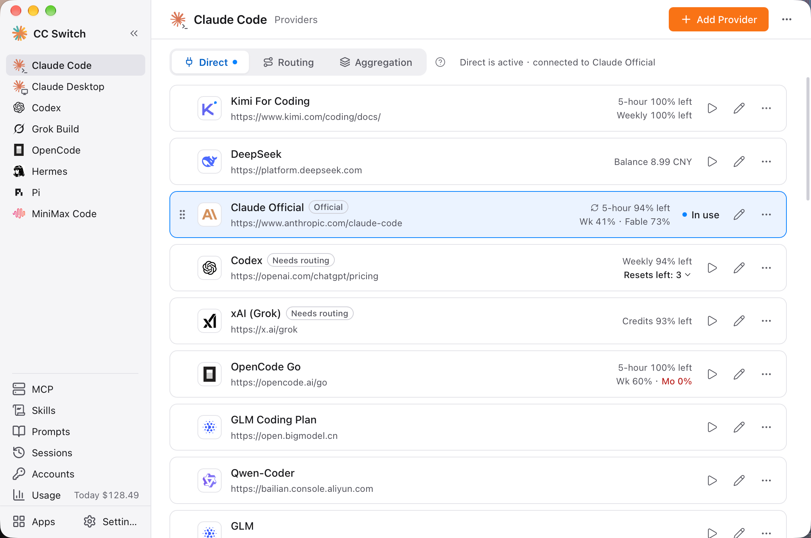
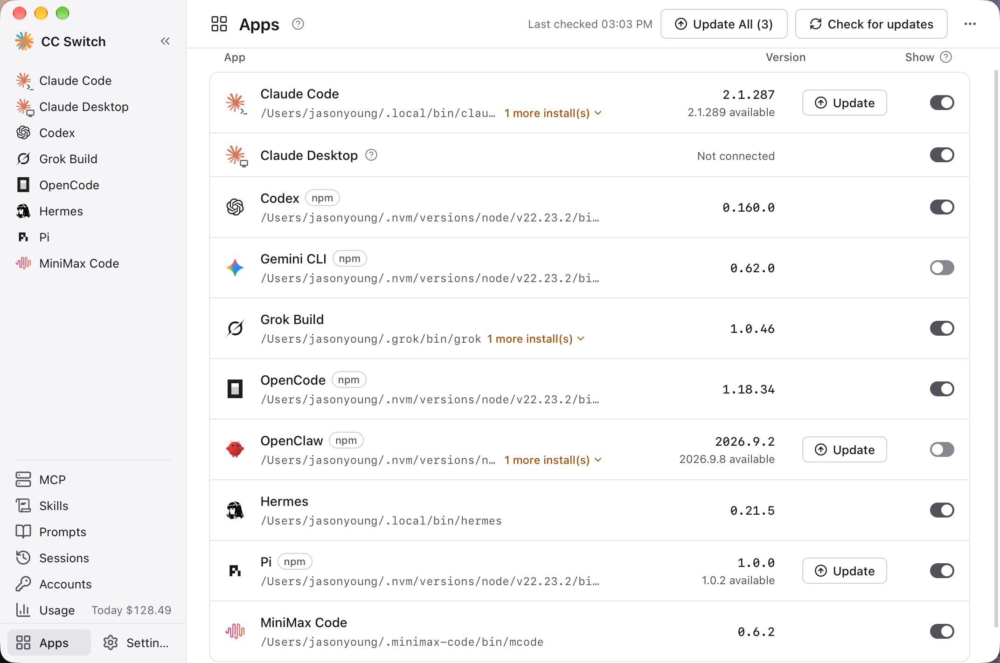
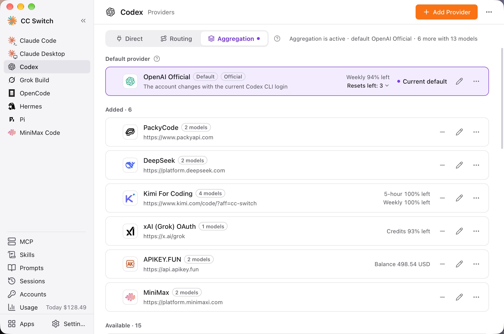
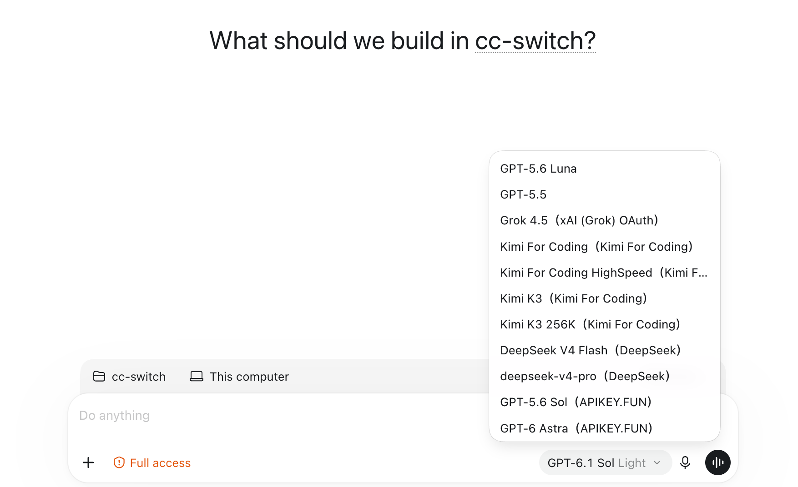
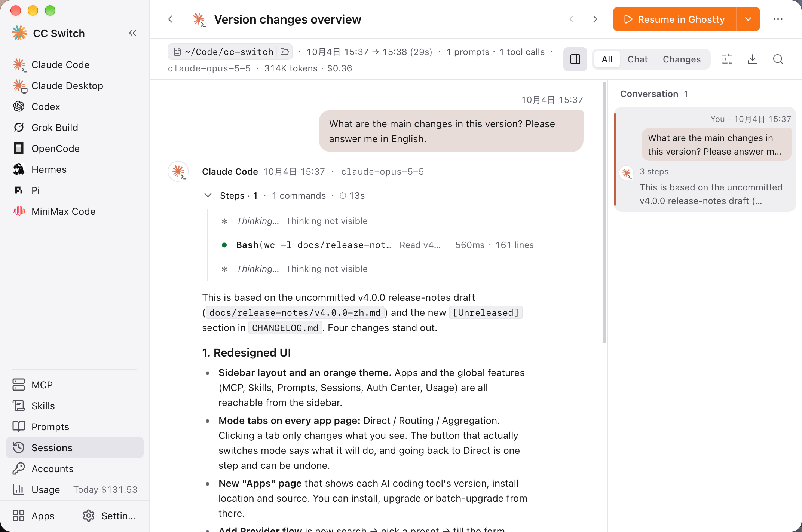
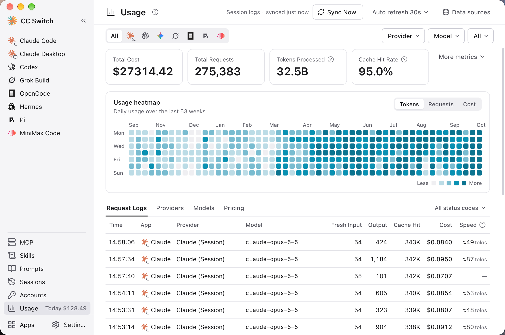

<div align="center">

# CC Switch

## [⬇ CC Switch Custom — Windows / macOS](https://github.com/asd260531078/cc-switch-custom/releases/latest)

### Claude Code、Claude Desktop、Codex、Gemini CLI、Grok Build、OpenCode、OpenClaw、Hermes Agent、Pi、MiniMax Code、Kimi Code 與 Oh My Pi 的全方位管理工具

**一鍵切換 API 供應商，集中管理 MCP、Skills 與提示詞，不必再手動編輯 JSON / TOML / YAML 設定檔。**

[](https://github.com/asd260531078/cc-switch-custom/releases)
[](https://github.com/asd260531078/cc-switch-custom/releases)
[](https://tauri.app/)
[](https://github.com/asd260531078/cc-switch-custom/releases/latest)

<a href="https://trendshift.io/repositories/15372" target="_blank"></a>
<a href="https://www.star-history.com/#farion1231/cc-switch&Date"><picture><source media="(prefers-color-scheme: dark)" srcset="https://api.star-history.com/badge?repo=farion1231/cc-switch&theme=dark" /></picture></a>

<a href="https://trendshift.io/repositories/15372?utm_source=trendshift-badge&amp;utm_medium=badge&amp;utm_campaign=badge-trendshift-15372" target="_blank" rel="noopener noreferrer"></a>
<a href="https://trendshift.io/repositories/15372?utm_source=trendshift-badge&amp;utm_medium=badge&amp;utm_campaign=badge-trendshift-15372" target="_blank" rel="noopener noreferrer"></a>
<a href="https://trendshift.io/repositories/15372?utm_source=trendshift-badge&amp;utm_medium=badge&amp;utm_campaign=badge-trendshift-15372" target="_blank" rel="noopener noreferrer"></a>

### 🌐 唯一官方網站：**[ccswitch.io](https://ccswitch.io)**

[English](README.md) | [简体中文](README_ZH.md) | 繁體中文 | [日本語](README_JA.md) | [한국어](README_KO.md) | [Türkçe](README_TR.md) | [Русский](README_RU.md) | [Deutsch](README_DE.md) | [更新日誌](CHANGELOG.md)

**[下載與安裝](#下載與安裝) · [快速開始](#快速開始) · [功能特性](#功能特性) · [常見問題](#常見問題) · [使用手冊](docs/user-manual/zh/README.md)**

</div>

本儲存庫客製原始碼版本為 `4.0.3801`，以官方 `v4.0.38` 正式版為基礎。[版本說明](docs/release-notes/v4.0.3801-zh.md)包含資料庫升級和回退步驟。Windows x64 與 macOS Universal 安裝包請見[本儲存庫 Releases](https://github.com/asd260531078/cc-switch-custom/releases/latest)。下方 Homebrew 與 Linux 安裝方式適用於官方發行版。


## 為什麼選擇 CC Switch？

Claude Code、Codex、Gemini CLI 等 AI 程式開發工具各有自己的設定格式。切換 API 供應商意味著要手動編輯 JSON、TOML、YAML 或 `.env` 檔案，MCP、Skills 與提示詞也得在每個工具中分別維護。

**CC Switch** 把這一切整合進單一桌面應用程式：選擇預設、輸入金鑰，一鍵切換。切換時只會替換連線資訊——端點、金鑰與模型——因此你自己加入的外掛、Hook、MCP 與註解都會原封不動。

- **一個應用程式，十二種工具** — Claude Code、Claude Desktop、Codex、Gemini CLI、Grok Build、OpenCode、OpenClaw、Hermes、Pi、MiniMax Code、Kimi Code 與 Oh My Pi
- **告別手動編輯** — 90+ 個供應商預設，包含 AWS Bedrock、NVIDIA NIM 與社群中轉服務
- **直連、路由或聚合，隨你選擇** — 直連讓工具直接連到供應商；路由則讓請求經由你的電腦轉發，轉換 API 格式並自動故障轉移，讓你能在 Claude Code 中使用 GPT、在 Codex 中使用 Claude；聚合會把多個供應商的模型放進 Claude Code 或 Codex 的同一份模型清單，每個請求都會送往你所選模型所屬的供應商
- **集中管理 MCP、Skills 與提示詞** — MCP 伺服器和 Skills 只需新增一次，再選擇要同步到哪些工具；提示詞則依各工具分別維護
- **看得懂的工作階段** — 把各工具的工作階段日誌整理成閱讀檢視：每一輪做了什麼、改了哪些檔案、哪一步失敗，一目了然
- **用量與額度一目了然** — 即使沒有啟用本地路由也能追蹤 Token 用量與花費；訂閱剩餘額度與帳戶餘額直接顯示在供應商卡片與系統匣上
- **跨平台** — 以 Tauri 2 打造的原生桌面應用程式，支援 Windows、macOS 與 Linux

## 螢幕截圖

<table>
<tr>
<td align="center" width="50%"><br>主介面</td>
<td align="center" width="50%"><br>應用頁面</td>
</tr>
<tr>
<td align="center"><br>聚合模式</td>
<td align="center"><br>Codex 中的聚合模型清單</td>
</tr>
<tr>
<td align="center"><br>工作階段閱讀檢視</td>
<td align="center"><br>用量統計</td>
</tr>
</table>

## 下載與安裝

### 系統需求

- **Windows**：Windows 10 及以上
- **macOS**：macOS 12（Monterey）及以上
- **Linux**：x86_64 或 ARM64，glibc 2.35+ 並具備 WebKitGTK 4.1——例如 Ubuntu 22.04+、Debian 12+ 與較新的 Fedora 版本；尚不支援 RHEL / Rocky / Alma 8–9

### Windows 使用者

[Download Windows 10/11 x64 installers](https://github.com/asd260531078/cc-switch-custom/releases/latest): MSI or Portable ZIP.

### macOS 使用者

**方式一：透過 Homebrew 安裝（建議）**

```bash
brew install --cask cc-switch
```

更新：

```bash
brew upgrade --cask cc-switch
```

**方式二：手動下載**

從 [Releases](https://github.com/asd260531078/cc-switch-custom/releases/latest) 頁面下載 `CC-Switch-v{version}-macOS.dmg`（建議）或 `.zip`。這是 Universal 版本，可在 Apple Silicon 與 Intel Mac 上原生執行。

> **注意**：macOS 版 CC Switch 已通過程式碼簽署並經 Apple 公證，可直接安裝並開啟。

### Arch Linux 使用者

**透過 paru 安裝（建議）**

```bash
paru -S cc-switch-bin
```

### Linux 使用者

請從 [Releases](https://github.com/farion1231/cc-switch/releases) 頁面下載最新的 Linux 版本：

- `CC-Switch-v{version}-Linux-x86_64.deb` / `-Linux-arm64.deb`（Debian/Ubuntu）
- `CC-Switch-v{version}-Linux-x86_64.rpm` / `-Linux-arm64.rpm`（Fedora 及其他附帶 WebKitGTK 4.1 的 RPM 發行版）
- `CC-Switch-v{version}-Linux-x86_64.AppImage` / `-Linux-arm64.AppImage`（任何符合上述需求的發行版）

> **Flatpak**：官方發行版不提供。你可以自行從 `.deb` 建置——步驟請見 [`flatpak/README.md`](flatpak/README.md)。

## 快速開始

### 基本使用

1. **新增供應商**：在側欄選擇要管理的工具，然後點擊頁面右上角的「+」（新增供應商）→ 選擇預設或建立自訂設定
2. **切換供應商**：
   - 主介面：選擇供應商 → 點擊「啟用」（OpenCode、OpenClaw、Hermes、MiniMax Code 與 Kimi Code 的按鈕是「新增」，Pi 與 Oh My Pi 則是「啟用」/「移除」；這七個是共存式工具，可以同時新增多個供應商）
   - 系統匣：每個工具一列，顯示「名稱 · 模式 · 供應商 · 額度」；在其子選單中點擊供應商名稱即可切換（Claude Code、Claude Desktop、Codex、Gemini CLI 與 Grok Build）
3. **生效方式**：Claude Code 無需重新啟動；Codex、Gemini CLI 與 Grok Build 請重新啟動終端機或 CLI 工具；Claude Desktop 則需重新啟動應用程式本身（見常見問題）
4. **回到官方登入**：在清單中切換到內建的官方供應商（例如「Claude Official」），重新啟動工具，再依照其登入 / OAuth 流程操作
5. **路由與聚合（選用）**：Claude Code、Codex、Gemini CLI 與 Grok Build 頁面頂端有「直連」/「路由」分頁，Claude Code 與 Codex 另有「聚合」。點擊分頁只會改變你正在檢視的內容，不會動到你的設定；要真正切換，請在頁面上點擊「開始路由」或「切換到聚合模式」，並點擊「回到直連」返回。想在 Claude Code 中使用 OpenAI 或 Gemini 格式的供應商、或在 Codex 中使用 Claude，請用路由；想在同一份模型清單中混用多個供應商的模型，請用聚合
6. **管理工具**：側欄的「應用」頁面集中顯示各 AI 程式開發工具的版本、安裝位置與來源；你可以安裝、升級或全部升級，並選擇哪些工具顯示在側欄

### MCP、提示詞、Skills、專案與工作階段

- **MCP**：點擊側欄的「MCP」→ 透過範本或自訂設定新增伺服器（或「匯入已有」）→ 為每個工具切換同步開關
- **提示詞**：點擊側欄的「提示詞」→ 用 Markdown 編輯器建立提示詞 → 啟用其中一個，即可寫入該工具的提示詞檔案
- **Skills**：點擊側欄的「Skills」→「發現技能」→ 搜尋 skills.sh 或瀏覽 GitHub 儲存庫 → 一鍵安裝到支援的工具
- **專案**：先在「設定 → 通用」中開啟「顯示專案切換」，然後在 Claude Code、Claude Desktop 或 Codex 頁面，開啟頂端的專案切換器 →「新建專案」以儲存目前的設定；之後從切換器中選擇它，就能一次切換整套設定
- **工作階段**：點擊側欄的「工作階段」→ 瀏覽並搜尋對話歷史、開啟閱讀檢視，或還原各工具的工作階段
- **帳號**：點擊側欄的「授權中心」，登入 GitHub Copilot、ChatGPT、xAI（Grok）與 Kimi Code 帳號，將你的訂閱用作供應商。Kimi Code 支援多個官方帳號，每個帳號有獨立的憑證與原生供應商；首次登入會使用 Kimi 原生的預設憑證槽位。登入、重新驗證與登出都在這裡管理。仍存在於原生設定中的 Kimi 官方 OAuth 節點會在供應商頁面受到保護；已儲存的設定檔可在其原生節點移除後刪除。

> **注意**：首次啟動時，CC Switch 會自動把你現有的 Claude Code、Codex、Gemini CLI 與 Grok Build 設定匯入為名為 `default` 的供應商，並為這些工具與 Claude Desktop 各新增一個官方供應商，因此你原有的設定不會遺失。

各項功能的詳細說明請參閱 **[使用手冊](docs/user-manual/zh/README.md)**，涵蓋供應商管理、MCP/提示詞/Skills、本地路由與故障轉移等內容。

## 功能特性

[完整更新日誌](CHANGELOG.md) | [v4.0 發布說明](docs/release-notes/v4.0.4-en.md)

### 各工具支援的功能

| 工具 | 供應商 | 本地路由 | 聚合 | 系統匣切換 | MCP | Skills | 提示詞 | 工作階段 | 用量統計 |
| --- | --- | :---: | :---: | :---: | :---: | :---: | --- | :---: | :---: |
| Claude Code | 切換 | ✓ | ✓ | ✓ | ✓ | ✓ | CLAUDE.md | ✓ | ✓ |
| Claude Desktop | 切換 | 僅模型映射 | – | ✓ | – | – | – | – | 僅模型映射 |
| Codex | 切換 | ✓ | ✓ | ✓ | ✓ | ✓ | AGENTS.md | ✓ | ✓ |
| Gemini CLI | 切換 | ✓ | – | ✓ | ✓ | ✓ | GEMINI.md | ✓ | ✓ |
| Grok Build | 切換 | ✓ | – | ✓ | ✓ | ✓ | AGENTS.md | ✓ | ✓ |
| OpenCode | 共存 | – | – | – | ✓ | ✓ | AGENTS.md | ✓ | ✓ |
| OpenClaw | 共存 | – | – | – | – | – | 工作區編輯器 | ✓ | – |
| Hermes | 共存 | – | – | – | ✓ | ✓ | 記憶 | ✓ | – |
| Pi | 共存 | – | – | – | ✓ | ✓ | AGENTS.md、SYSTEM.md、提示詞範本 | ✓ | ✓ |
| MiniMax Code | 共存 | – | – | – | ✓ | ✓ | AGENTS.md | ✓ | ✓ |
| Kimi Code | 共存 | – | – | – | ✓ | ✓ | AGENTS.md | ✓ | ✓ |
| Oh My Pi | 共存 | – | – | – | ✓ | ✓ | AGENTS.md | ✓ | – |
| CodeBuddy | 共存 | – | – | – | ✓ | ✓ | CODEBUDDY.md | ✓ | ✓ |

- **切換**：同一時間只有一個供應商生效；**共存**：多個供應商會同時寫入該工具自己的設定，由你在工具內挑選其中一個。
- **本地路由**：CC Switch 在你的電腦上轉發請求並轉換 API 格式；詳見下方的[本地路由與故障轉移](#本地路由與故障轉移)。Claude Desktop 的供應商可使用「直連」或「模型映射」；使用「模型映射」時，請求會經過本地路由。
- **聚合**：把多個供應商的模型放進同一份模型清單，並將每個請求送往你所選模型所屬的供應商；詳見下方的[聚合模式](#聚合模式)。
- **工作階段**：瀏覽並搜尋對話歷史、開啟閱讀檢視，並複製還原指令以繼續對話（尚不支援還原 OpenClaw 與 Hermes 的工作階段）。Hermes 只顯示最近的 500 個工作階段。
- **用量統計**：沒有本地路由時，用量會從各工具的本機工作階段日誌收集；經過本地路由的請求同樣會被統計。
- 從 Claude Desktop 頁面開啟的 MCP、Skills、提示詞與工作階段面板，作用對象是 Claude Code。

### 供應商管理

- **90+ 個供應商預設** — 選擇預設並輸入金鑰即可新增供應商，也可建立自訂設定。新增面板支援依名稱（包含中文名稱）與網域搜尋，同一家廠商的不同方案與地區會合併成一列
- **只動關鍵欄位** — 切換時只會替換端點、金鑰與模型等連線資訊；外掛、Hook、MCP、你自己加入的設定與註解都保持原樣。編輯器會顯示切換後設定檔的樣子，CC Switch 也會在第一次改寫每個設定檔之前自動備份
- **專案** — 把 Claude Code 或 Codex 目前的供應商、MCP、Skills 與提示詞檔案儲存為一個專案（Claude Desktop 只儲存供應商），之後可從頁面頂端的專案切換器或系統匣一鍵切換整套設定；切換到另一個專案時，目前的狀態會自動存回前一個專案。專案切換器預設隱藏，請在「設定 → 通用」中開啟「顯示專案切換」
- **帳號（Beta）** — 在側欄的「授權中心」登入多個 GitHub Copilot、ChatGPT 與 xAI（Grok）帳號，並將這些訂閱用作 Claude Code、Claude Desktop 與 Codex 的供應商（除 Codex 的 OpenAI Official 外，都必須在路由模式下使用）。在官方用戶端之外使用訂閱可能違反廠商的服務條款，請自行評估風險
- **Claude Desktop 的第三方供應商** — 直接連接 Anthropic 相容端點；對於非 Claude 模型，請選擇「模型映射」，透過本地路由把 Sonnet、Opus、Haiku 等檔位對應到供應商的實際模型
- **通用供應商** — 一份設定即可同步到 Claude Code、Codex 與 Gemini CLI
- 一鍵切換、系統匣快速切換（Claude Code、Claude Desktop、Codex、Gemini CLI、Grok Build）、拖曳排序、匯入/匯出

### 本地路由與故障轉移

- **API 格式轉換** — 本地路由可在 Anthropic Messages、OpenAI Chat Completions、OpenAI Responses 與 Gemini Native 之間轉換請求：Claude Code 與 Claude Desktop 可使用 OpenAI 或 Gemini 格式的供應商，Codex 與 Grok Build 則可使用 Chat Completions 或 Anthropic Messages 的供應商
- **按工具獨立開關** — Claude Code、Codex、Gemini CLI 與 Grok Build 可分別進入路由模式：在頁面頂端的「路由」分頁點擊「開始路由」。在路由模式下，切換供應商會立即對後續請求生效（若切換會更動模型，Codex、Gemini CLI 與 Grok Build 可能仍需重新啟動）。結束 CC Switch 時，它會先把直連設定寫回，並在下次啟動時重新接上
- **自動故障轉移** — 為每個工具設定故障轉移佇列；請求失敗時，CC Switch 會自動改用佇列中的下一個供應商，並有熔斷器與供應商健康監控作為後盾
- **整流器** — 自動修正部分上游無法處理的請求（例如 Thinking 簽章，或在不支援圖片時降級處理）
- 官方供應商（例如 Claude Official）無法經過本地路由（Codex 的 OpenAI Official 除外）
- 路由服務的狀態、監聽位址與故障轉移設定都在「設定 → 本地路由」中
- 指南：[在 Claude Code 中使用 GPT](docs/guides/claude-codex-routing-guide-en.md) · [在 Codex 中使用 Claude](docs/guides/codex-claude-routing-guide-en.md)

### 聚合模式

- **一份模型清單，多個供應商** — 在 Claude Code 或 Codex 頁面切換到「聚合」並新增幾個供應商，它們的模型都會出現在用戶端的模型選擇器中。每個請求都會送往你所選模型所屬的供應商，無需在 CC Switch 中切換
- **隨時新增與移除** — 在供應商卡片上點擊「新增」或「移除」，再選一個供應商作為預設；未指定聚合模型的請求會送往它。Codex 的 OpenAI Official 只能作為預設供應商；聚合模式目前不支援 Claude 官方訂閱
- **注意事項** — 聚合不提供故障轉移；Claude Code 需要 2.1.243 或更新版本；聚合清單變動後，Codex 需要重新啟動，Claude Code 則不用。在同一工作階段中切換模型時，新模型必須重建提示詞快取，因此第一輪的花費會略高
- 聚合模式的許多設計參考了 [opencodex](https://github.com/lidge-jun/opencodex)——感謝其作者與貢獻者
- 文件：[聚合模式手冊](docs/user-manual/en/4-proxy/4.6-aggregation.md) · [圖文指南（中文）](docs/guides/aggregation-mode-guide-zh.md)

### MCP、提示詞與 Skills

- **統一的 MCP 面板** — 在同一處管理所有 MCP 伺服器，選擇每個伺服器要同步到哪些工具（Claude Code、Codex、Gemini CLI、Grok Build、OpenCode、Hermes、Pi、MiniMax Code、Kimi Code、Oh My Pi、CodeBuddy），從各工具匯入現有設定，並可透過 Deep Link 匯入
- **提示詞** — 依工具分別建立的提示詞庫，附 Markdown 編輯器；啟用提示詞時會將其寫入該工具的提示詞檔案（CLAUDE.md / AGENTS.md / GEMINI.md），並先把檔案現有的內容存回提示詞庫，確保不會遺失任何內容。Pi 還可編輯 SYSTEM.md、APPEND_SYSTEM.md 與提示詞範本
- **Skills** — 搜尋 skills.sh，或從 GitHub 儲存庫或 ZIP 檔案一鍵安裝；可檢查更新並一鍵全部更新；可自動同步到各工具、僅用符號連結，或僅用複本；也可選擇存放在 `~/.agents/skills`
- 三個面板都支援搜尋，MCP 與 Skills 還可依工具一次全部啟用或停用；供應商、MCP 伺服器與提示詞都在內容區以整頁方式編輯，離開時若有未儲存的變更會先提醒你

### 用量與費用追蹤

- **用量儀表板** — 不需要本地路由：預設會自動掃描各工具的本機工作階段日誌，並依供應商與模型追蹤請求數、Token、快取命中率、輸出速度與花費，附趨勢圖、全年熱力圖與逐筆請求日誌
- **額度與餘額** — 供應商卡片與系統匣會顯示剩餘額度與重置倒數，例如「5h 94% left」：官方訂閱額度（Claude、ChatGPT、Gemini、SuperGrok）、Coding Plan 的 5 小時 / 每週 / 每月額度（Kimi、智譜 GLM、MiniMax、火山方舟等），以及帳戶餘額（DeepSeek、OpenRouter、矽基流動等）；部分需要先在供應商卡片上透過「設定用量查詢」開啟，其他供應商則可撰寫自訂用量指令碼。ChatGPT 訂閱還會顯示剩餘的額度重置次數與 Codex Credits 餘額
- **自訂定價** — 可為每個模型設定價格，或從 models.dev 匯入

### 工作階段管理與工作區

- **工作階段閱讀檢視** — 將各工具的工作階段日誌解析為結構化內容：文字、思考、工具呼叫、工具結果與圖片分別顯示；每一輪工作會收合成一行摘要（幾個步驟、改了幾個檔案、幾次失敗），失敗的步驟以紅色標示；右側有對話大綱，並支援工作階段內搜尋、Markdown 匯出，以及複製單一輪次或整段對話
- **清單與還原** — 依專案或時間分組，可搜尋標題、目錄、訊息或工作階段 ID，並可批次刪除；複製還原指令即可繼續對話，在 macOS 上還可一鍵在終端機中還原
- **工作區編輯器**（OpenClaw） — 編輯 Agent 檔案（AGENTS.md、SOUL.md 等）與每日記憶
- **記憶**（Hermes） — 編輯 Hermes 的 MEMORY.md 與 USER.md

### 系統與平台

- **雲端同步** — 透過 WebDAV（堅果雲、Nextcloud、Synology NAS 等）或相容 S3 的儲存空間（AWS S3、Cloudflare R2、阿里雲 OSS、騰訊雲 COS 等）在多台裝置間同步；你也可以把 CC Switch 設定目錄放進 Dropbox、OneDrive 或 iCloud 等雲端硬碟資料夾
- **CLI 工具管理** — 在側欄的「應用」頁面查看 Claude Code、Codex 等命令列工具的目前版本與最新版本，一鍵安裝、升級或全部升級，並診斷重複安裝；在 Windows 上也能管理 WSL 內的工具（見常見問題）
- **Deep Link**（`ccswitch://`） — 透過連結一鍵匯入供應商、MCP 伺服器與提示詞，或新增 Skill 儲存庫；可用[線上產生器](https://ccswitch.io/deplink.html)建立連結；想提供匯入按鈕的網站擁有者可參考[整合指南](https://github.com/farion1231/cc-switch/blob/main/docs/guides/deeplink-site-integration-guide-en.md)
- **內建小工具** — 略過 Claude Code 的首次執行確認、隱藏 AI 署名、讓 VS Code 的 Claude Code 擴充功能跟隨 CC Switch 的供應商切換等
- 深色 / 淺色 / 跟隨系統主題、開機自動啟動、自動更新、原子寫入、自動備份（在「設定 → 資料」中可查看每份備份的位置與佔用空間）、多語系介面（簡體中文、繁體中文、英文、日文、韓文、土耳其文、俄文、德文）

## 常見問題

<details>
<summary><strong>CC Switch 支援哪些 AI 工具？</strong></summary>

CC Switch 支援十二個工具：**Claude Code**、**Claude Desktop**、**Codex**、**Gemini CLI**、**Grok Build**、**OpenCode**、**OpenClaw**、**Hermes**、**Pi**、**MiniMax Code**、**Kimi Code**、**Oh My Pi**。每個工具都有專屬的供應商預設與設定管理；各工具支援的功能請見[各工具支援的功能](#各工具支援的功能)。

</details>

<details>
<summary><strong>切換供應商後需要重新啟動終端機嗎？</strong></summary>

視工具而定：

- **Claude Code**：支援供應商資料熱切換，無需重新啟動。
- **Codex、Gemini CLI、Grok Build**：請重新啟動終端機或 CLI 工具，變更才會生效（切換後 CC Switch 會提醒你）。在路由模式下，請求會立即送往新的供應商，但若切換會更動模型，這三個工具仍可能需要重新啟動。
- **聚合模式**：Claude Code 聚合模型的變更會立即生效；Codex 進入或離開聚合、以及變更聚合模型清單，都需要完整重新啟動——見下一則。
- **Claude Desktop**：完全結束並重新開啟 Claude Desktop；使用「模型映射」時，也請保持 CC Switch 執行中。
- **OpenCode、OpenClaw、Hermes、Pi、MiniMax Code、Kimi Code、Oh My Pi**：這些是共存式工具——點擊「新增」（Pi 與 Oh My Pi 為「啟用」）會把供應商與其他供應商一起寫入工具自己的設定；之後再到工具內選擇你要的模型。Kimi Code 還提供「切換」按鈕來選擇供應商的模型；仍被設為主要或次要模型的模型無法移除。設定與帳號詳情請見 [Kimi Code 整合指南](docs/kimi-code-integration-zh.md)（中文）。

</details>

<details>
<summary><strong>聚合模式下，為什麼聚合的模型沒有出現在 Codex 的 /model 中？</strong></summary>

Codex 只會在啟動時讀取模型清單。進入或離開聚合模式、新增或移除聚合供應商，或變更供應商的聚合模型後，請完整重新啟動 Codex 才能看到新的清單：

- **Codex CLI**：關閉終端機再執行 `codex` 並不夠。所有終端機中的每個 `codex` 共用同一個背景常駐程式，必須重新啟動它才會讀取新的清單。當 CC Switch 偵測到 Codex 仍在使用舊清單時，會在 Codex 頁面頂端顯示提示；請點擊提示中的「重新啟動 Codex 守護行程」。重新啟動會中斷常駐程式中正在執行的任何任務。
- **Codex 桌面應用程式**：完全結束後重新開啟（在 macOS 上按 ⌘Q；只關閉視窗並不夠）。
- **編輯器擴充功能**：重新開啟編輯器視窗。

Claude Code 不受影響：聚合模型的變更會立即生效。

</details>

<details>
<summary><strong>切換供應商會更動我的外掛、Hook 或其他設定嗎？</strong></summary>

不會。為 Claude Code、Codex、Gemini CLI 或 Grok Build 切換供應商時，CC Switch 只會替換設定檔中的**關鍵欄位**：端點、金鑰、模型名稱與 API 協定（Codex 另含推理強度，Gemini CLI 另含驗證方式），以及少數屬於供應商的相容性選項（例如 Claude Code 的「停用 Artifact 工具」與上下文視窗）。外掛、Hook、權限、MCP、你自己加入的環境變數、註解與格式都保持原樣，並適用於每個供應商。

你可以在工具本身或手動編輯設定檔來變更這些共用設定。你也可以在 CC Switch 中編輯任一供應商：編輯器會顯示「切換到此供應商後設定檔的樣子」。儲存時，關鍵欄位會存入該供應商，其餘所有變更則寫入設定檔，並適用於每個供應商。

因此舊有的「通用設定片段」已不再需要，其按鈕也已移除。升級前在片段中的設定，早在你切換時就已寫入設定檔，所以會保留下來。CC Switch 在第一次改寫每個設定檔之前，也會把原始檔案備份到 `~/.cc-switch/backups/live-first-write/`。

</details>

<details>
<summary><strong>我在工具內改了模型，為什麼切換走再切換回來後又變回去了？</strong></summary>

模型是關鍵欄位，屬於供應商。你在工具內選擇的模型（例如在 Claude Code 中使用 `/model`）會一直生效到下次切換；切換時，設定檔中的模型會被替換成目標供應商中儲存的模型，而 CC Switch 不會把你選擇的模型存回前一個供應商。若想長期使用某個模型，請在 CC Switch 中編輯該供應商。

舊版本在你切換離開時，會把整個設定檔存回供應商。現在已不再這樣做：那會把外掛與其他共用設定凍結在單一供應商中，切換到別的供應商時就會遺失。

</details>

<details>
<summary><strong>為什麼無法刪除目前使用中的供應商？</strong></summary>

CC Switch 遵循「最小侵入」的設計原則——即使你解除安裝本應用程式，你的工具仍能正常運作。

因此，對於同一時間只使用一個供應商的工具（Claude Code、Claude Desktop、Codex、Gemini CLI、Grok Build），系統一律會保留一份使用中的設定，因為刪除所有設定會讓對應的工具無法使用；若要刪除，請先切換到其他供應商。同樣地，聚合模式的預設供應商也無法移除；請先將另一個供應商設為預設。共存式工具（OpenCode、OpenClaw、Hermes、Pi 與 MiniMax Code）不受此限制——你可以直接刪除任何供應商。如果你很少使用某個工具，可以在「應用」頁面將它從側欄隱藏。若要切換回官方登入，請見下一個問題。

</details>

<details>
<summary><strong>如何切換回官方登入？</strong></summary>

在 CC Switch 中，Claude Code、Claude Desktop、Codex、Gemini CLI 與 Grok Build 的供應商清單各自包含一個內建的官方供應商（**Claude Official**、**Claude Desktop Official**、**OpenAI Official**、**Google Official**、**Grok Official**）；如果你刪除了它，可以從預設中重新新增。切換到官方供應商後，請依照工具自己的登入流程操作（例如 Claude Code 的 `/login`、Codex 的 `codex login`），之後你就能在官方供應商與第三方供應商之間自由切換。

對於 Codex，你也可以在 CC Switch 內透過「Sign in with ChatGPT」登入多個 ChatGPT 帳號，並為每張 **OpenAI Official** 卡片選擇「使用的帳號」，只需一鍵就能在多個 Plus、Pro 或 Team 帳號之間切換；設為「跟隨 Codex 登入」的卡片則會繼續使用 Codex CLI 自己的登入。

注意：官方訂閱使用工具自己的登入，不會經過本地路由。路由模式下無法選擇官方供應商（Codex 的 OpenAI Official 卡片除外）；請先切換回直連。

</details>

<details>
<summary><strong>開始路由後，為什麼我的設定檔指向 127.0.0.1？</strong></summary>

在路由模式下，工具的請求會先送到 CC Switch 的本地路由（預設為 `http://127.0.0.1:15721`），再由 CC Switch 轉發給你選擇的供應商。因此工具的設定檔裡只會有本機位址與預留位置金鑰 `PROXY_MANAGED`；對於 Claude Code，模型名稱也會寫成固定的別名，例如 `claude-sonnet-5`（`/model` 選單仍會顯示真實的模型名稱）。真實的供應商位址、金鑰與模型都儲存在 CC Switch 中。聚合模式的運作方式相同。

在側欄「用量統計」的請求日誌中，你可以看到每個請求的「請求的模型 → 實際的模型」。

在路由模式下，切換改變的是路由所使用的供應商；你在進入路由之前使用的供應商維持不變，並在其卡片上標示為「直連」。當你點擊「回到直連」時，設定檔會被寫回這個直連供應商的設定。結束 CC Switch 時也會先寫回直連供應商，並在下次啟動 CC Switch 時重新接上。

</details>

<details>
<summary><strong>可以在 Claude Code 中使用 OpenAI 相容 API、Gemini 或本地模型嗎？</strong></summary>

可以，但需要使用路由。編輯供應商時，請將「進階選項」中的「上游格式」設為與供應商 API 相符：只提供 Chat Completions 端點的服務（許多本地模型伺服器都是如此）請選「OpenAI Chat Completions」，提供 Responses 端點的服務請選「OpenAI Responses API」，Gemini 請選「Gemini Native generateContent」。然後在 Claude Code 頁面的「路由」分頁點擊「開始路由」。選錯格式或沒有開始路由，通常會出現 404 或 405 錯誤。

反過來說，在 Codex 或 Grok Build 中將「上游格式」選為「Anthropic Messages」，就能使用 Claude 格式的供應商；這同樣需要路由。詳情請見[在 Claude Code 中使用 GPT](docs/guides/claude-codex-routing-guide-en.md)與[在 Codex 中使用 Claude](docs/guides/codex-claude-routing-guide-en.md)。

</details>

<details>
<summary><strong>「檢測連通」通過了，為什麼請求還是失敗？</strong></summary>

供應商卡片上的「檢測連通」只會檢查供應商位址是否可連線，並不會送出真正的模型請求，因此無法驗證 API 金鑰與模型名稱是否正確。請求失敗時，請檢查金鑰、模型名稱與上游格式；對於經過路由的請求，你也可以在側欄「用量統計」的請求日誌中看到確切的錯誤。

</details>

<details>
<summary><strong>我的資料存放在哪裡？</strong></summary>

預設情況下，所有資料都存放在你使用者主目錄下的 `.cc-switch` 資料夾（Windows 上為 `C:\Users\<user>\.cc-switch`）：

- **資料庫**：`cc-switch.db`（SQLite——供應商、MCP、提示詞、Skills、專案、用量記錄等）
- **本機設定**：`settings.json`（裝置層級的設定，例如各工具的設定目錄、備份策略與雲端同步連線資訊）
- **備份**：`backups/`（預設每 24 小時自動備份一次，保留最近 10 份；可在「設定 → 資料 → 備份與還原」中調整；其下的「其他備份」會列出其他所有備份的位置與大小，可依類別清理）
- **Skills**：`skills/`（可在設定中改為 `~/.agents/skills`），預設透過符號連結同步到各工具，失敗時退回複製
- **Skill 備份**：`skill-backups/`（在解除安裝或更新 Skill 之前自動建立，保留最近 20 份）
- **OAuth 登入憑證**：`copilot_auth.json`、`codex_oauth_auth.json`、`xai_oauth_auth.json`
- **日誌**：`logs/cc-switch.log` 與 `crash.log`——回報問題時請附上
- **裝置狀態**：`live-state.json`（各工具目前處於直連、路由或聚合模式，以及最後寫入的內容）、`codex-login-stash.json`（切換到第三方供應商時暫存起來的 Codex 官方登入，切換回官方供應商時會還原）
- **原始設定檔**：`backups/live-first-write/`（CC Switch 第一次改寫之前各工具設定檔的原樣）

在「設定 → 資料 → 儲存位置」中變更「CC Switch 設定目錄」後，除了 `settings.json`、裝置狀態與原始設定檔之外，上述所有檔案都會存放在新目錄中。CC Switch 不會自動搬移既有檔案，請先手動複製過去。`settings.json`、裝置狀態與原始設定檔只屬於這台電腦：它們一律保留在預設目錄，也不會納入雲端同步。

</details>

<details>
<summary><strong>如何在 Windows 上管理 WSL 內的工具？</strong></summary>

CC Switch 不會自動偵測 WSL。請在「設定 → 應用設定」中，把對應工具的設定目錄改成 WSL 內的路徑，例如 `\\wsl.localhost\Ubuntu\home\<user>\.claude`；儲存後，CC Switch 就會讀寫 WSL 內的設定（支援 Claude Code、Codex、Gemini CLI、Grok Build、OpenCode、OpenClaw、Hermes 與 Pi）。設定完成後，側欄的「應用」頁面也會偵測並升級對應 WSL 發行版中的該工具。

注意：路由與聚合會把 `127.0.0.1` 作為位址寫入設定。在 WSL2 預設的 NAT 網路模式下，WSL 內的 `127.0.0.1` 無法連到 Windows 上的本地路由；請改將 WSL 切換為鏡像網路模式。

</details>

<details>
<summary><strong>有命令列或無頭（headless）版本嗎？</strong></summary>

CC Switch 本身只以需要圖形介面的桌面應用程式形式發行（系統需求請見[下載與安裝](#下載與安裝)）。對於伺服器、SSH 連線或沒有桌面環境的機器，我們建議使用社群維護的 **[CC Switch CLI](https://github.com/SaladDay/cc-switch-cli)**：它同時提供互動式終端機介面（TUI）與命令列模式，支援 Claude Code、Codex、Gemini CLI、OpenCode、OpenClaw、Hermes 與 Pi，並可透過 Homebrew（`brew install cc-switch-cli`）或安裝指令碼安裝。

預設情況下，CC Switch CLI 與桌面應用程式共用 `~/.cc-switch` 資料目錄，並相容桌面應用程式的 WebDAV 同步。這兩個專案是分開發布的，CLI 支援的資料庫版本有時會落後於桌面應用程式；若你看到「資料庫版本過新」的訊息，請升級 CLI，或等待它跟上。

</details>

<details>
<summary><strong>Linux（Wayland + NVIDIA）：點擊沒有反應，且調整視窗大小時黑屏</strong></summary>

AppImage 會強制設定 `GDK_BACKEND=x11`（XWayland），以避開過去原生 Wayland 的當機問題。在較新的 Wayland + NVIDIA 環境中，這可能導致網頁內容區域無法點擊（標題列按鈕仍可使用），並在調整大小時黑屏。請使用選擇性啟用的逃生開關啟動，以切換回原生 Wayland：

```bash
CC_SWITCH_GDK_BACKEND=wayland ./CC-Switch-*.AppImage
```

如果你是從桌面圖示啟動，請把它加到 `.desktop` 檔的 `Exec=` 行（例如 `env CC_SWITCH_GDK_BACKEND=wayland /path/to/AppImage`），或設定在你的工作階段環境中。這個變數是通用的：在點擊沒有反應的平鋪式 Wayland 合成器（sway/Hyprland）上，請改試 `CC_SWITCH_GDK_BACKEND=x11`。不設定則維持預設行為。

</details>

更多問題請參閱使用手冊中的[常見問題](docs/user-manual/en/5-faq/5.2-questions.md)。

## 參與貢獻

歡迎提出 Issue 與建議！開發新功能之前，請先開一個 Issue 討論方案；不適合本專案的功能 PR 可能會被關閉。

開發環境設定、提交前檢查與架構說明請見 [CONTRIBUTING.md](CONTRIBUTING.md)；使用上的問題請先查看 [SUPPORT.md](SUPPORT.md)；安全漏洞請依 [SECURITY.md](SECURITY.md) 的說明私下回報。

**技術棧**：Tauri 2 · Rust · React 18 · TypeScript · SQLite

## Star 歷史

[](https://www.star-history.com/#farion1231/cc-switch&Date)

## 授權條款

MIT © Jason Young
